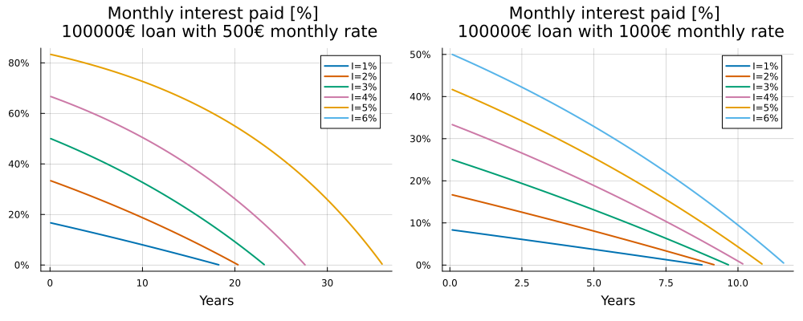
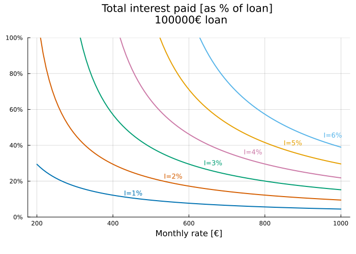

Here some plots showing the interests you pay to a bank.
Notation:

- $D$ : loan amount
- $R$ : monthly installment
- $I$ : nominal annual interest rate
- $i = \frac{I}{12}$ : monthly interest rate, 30/360 convention
- $N$ : total number of installments
- $T = D + Z$ : total paid (loan + interests)
- $Z$ : total interests paid

For the $n$-th installment:

- $d_n$ : debt left after the $n$-th installment ($d_0=D$)
- $p_n = R - i\,d_{n-1}$ : principal part of the $n$-th installment
- $z_n = i\,d_{n-1}$ : interest part of the $n$-th installment

