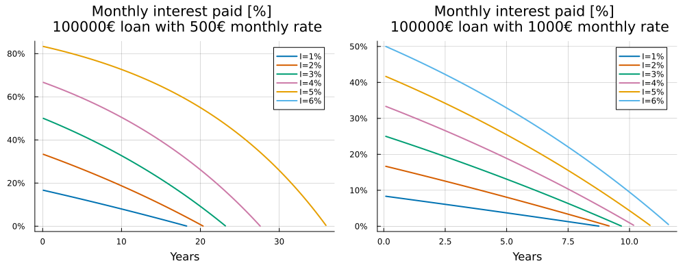
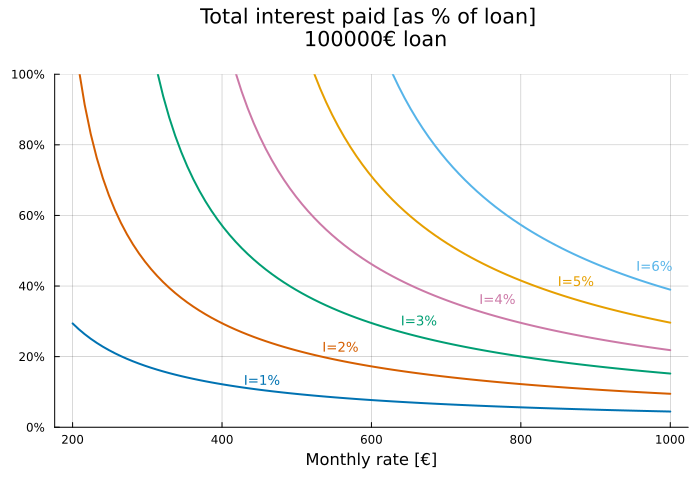

Here are some interactive plots of what a loan actually costs you. Most of a loan's
early payments are almost all interest, with only a trickle going to the principal;
the balance tips the other way only later on. Pick a loan and a rate below, then
either set the monthly installment and read off how long you will be paying, or set
the term and get the installment it implies. The curves and the summary follow as you
drag, and hovering a curve reads off its values.

Notation:

- $D$ : loan amount
- $R$ : monthly installment
- $I$ : nominal annual interest rate
- $i = \frac{I}{12}$ : monthly interest rate, 30/360 convention
- $N$ : total number of installments
- $T = D + Z$ : total paid (loan + interests)
- $Z$ : total interests paid

For the $n$-th installment:

- $d_n$ : debt left after the $n$-th installment ($d_0=D$)
- $p_n = R - i\,d_{n-1}$ : principal part of the $n$-th installment
- $z_n = i\,d_{n-1}$ : interest part of the $n$-th installment

The formulas used here are derived in [Bank interest functions: analytical derivation](../bank-loan-interest-derivation/index.qmd).

## Your loan

::: {.controls}
```{ojs}
viewof D = Inputs.range([10000, 500000], {value: 100000, step: 1000, label: "Loan D [€]"})
viewof I = Inputs.range([0.1, 10], {value: 3, step: 0.1, label: "Annual rate I [%]"})
viewof mode = Inputs.radio(new Map([["set the monthly installment", "R"], ["set the term", "N"]]), {value: "R", label: "I want to"})
viewof RN = mode === "R"
  ? Inputs.range([100, 5000], {value: 500, step: 10, label: "Installment R [€]"})
  : Inputs.range([1, 40], {value: 20, step: 1, label: "Term [years]"})
```
:::

```{ojs}
// ---- the model: everything follows from D, R and the monthly rate i = I/12 ----

// In "term" mode the monthly installment is whatever clears the loan in the
// chosen number of years; in "installment" mode it is the slider value.
installmentForTerm = (D, I, years) => {
  const i = I / 1200, N = Math.round(years * 12);
  return i === 0 ? D / N : i * Math.pow(1 + i, N) / (Math.pow(1 + i, N) - 1) * D;
}
R = mode === "R" ? RN : installmentForTerm(D, I, RN)

// Does the installment cover at least the first month of interest?
amortizes = (D, R, I) => R > (I / 1200) * D

// Number of installments N = ceil(n*), last installment, totals.
function loan(D, R, I) {
  const i = I / 1200;
  if (!amortizes(D, R, I)) return null;
  const nstar = (Math.log(R) - Math.log(R - i * D)) / Math.log1p(i);
  const N = Math.ceil(nstar - 1e-9);
  const q = Math.pow(1 + i, N);
  const Rlast = (R / i) * (1 + i) + (D - R / i) * q;
  const T = (N - 1) * R + Rlast;
  return {N, Rlast, T, Z: T - D};
}

// One row per installment: interest part z_n, principal part p_n, debt left d_n.
function schedule(D, R, I) {
  const L = loan(D, R, I);
  if (!L) return [];
  const i = I / 1200;
  let d = D;
  return d3.range(1, L.N + 1).map(n => {
    const z = i * d;
    const paid = n < L.N ? R : L.Rlast;
    d = Math.max(0, d - (paid - z));
    return {n, years: n / 12, z, p: paid - z, d, share: z / R, rate: I};
  });
}

rates = [1, 2, 3, 4, 5, 6]
color = I => `var(--chart-${I})`
eur = x => Math.round(x).toLocaleString("en-GB") + " €"
pct = d3.format(".1%")

mine = loan(D, R, I)
```

```{ojs}
mine
  ? html`<div class="stats">
      ${mode === "N" ? html`<div><div class="stat__label">Monthly installment</div>
           <div class="stat__value">${eur(R)}</div>
           <div class="stat__note">to clear it in ${RN} years</div></div>` : ""}
      <div><div class="stat__label">Installments</div>
           <div class="stat__value">${mine.N}</div>
           <div class="stat__note">${(mine.N / 12).toFixed(1)} years</div></div>
      <div><div class="stat__label">Total interest Z</div>
           <div class="stat__value">${eur(mine.Z)}</div>
           <div class="stat__note">${pct(mine.Z / D)} of the loan</div></div>
      <div><div class="stat__label">Total paid T</div>
           <div class="stat__value">${eur(mine.T)}</div>
           <div class="stat__note">last installment ${eur(mine.Rlast)}</div></div>
      <div><div class="stat__label">First installment</div>
           <div class="stat__value">${pct((I / 1200) * D / R)}</div>
           <div class="stat__note">of it is interest</div></div>
    </div>`
  : html`<p><strong>This loan is never repaid:</strong> the first month of interest is
      ${eur((I / 1200) * D)}, which is not less than the installment of ${eur(R)}. Raise <em>R</em> or lower <em>I</em>.</p>`
```

## Interest part of each installment

How much of the $n$-th installment is interest, $z_n / R$, for a loan of ${eur(D)} repaid with ${eur(R)} a month.
The blue curves are fixed annual rates from 1% to 6%, the orange one is your rate.
A rate whose first month of interest exceeds the installment has no curve: that loan is never repaid.

```{ojs}
curvesA = rates.flatMap(r => schedule(D, R, r))
mineA = schedule(D, R, I)
// One label per curve, sitting on the line a bit before its middle.
labelsA = rates.map(r => curvesA.filter(d => d.rate === r)).filter(c => c.length).map(c => c[Math.floor(c.length * 0.42)])

legend = () => html`<div class="chart-legend">
  ${rates.map(r => html`<span><i style="color:${color(r)}"></i>${r}%</span>`)}
  <span><i style="color:var(--chart-highlight)"></i>your rate, ${I.toFixed(1)}%</span>
</div>`

// Hover box in the page's own colours, so it is readable in light and dark.
tipStyle = ({fill: "var(--site-bg)", stroke: "var(--site-muted)", fontSize: 12})

// Curve labels: text in the page's ink with a halo in the background colour.
label = (data, x, y) => Plot.text(data, {x, y, text: d => `${d.rate}%`, fill: "currentColor", stroke: "var(--plot-background)", strokeWidth: 6, fontSize: 11})
```

::: {.chart}
```{ojs}
legend()
```

```{ojs}
Plot.plot({
  width,
  height: 360,
  marginTop: 30,
  marginLeft: 44,
  marginRight: 20,
  x: {label: "Years →", nice: true},
  y: {label: "↑ Interest part of the installment", tickFormat: "%", grid: true, zero: true},
  marks: [
    Plot.ruleY([0]),
    ...rates.map(r => Plot.lineY(curvesA.filter(d => d.rate === r), {x: "years", y: "share", stroke: color(r), strokeWidth: 2})),
    Plot.lineY(mineA, {x: "years", y: "share", stroke: "var(--chart-highlight)", strokeWidth: 2.5}),
    label(labelsA, "years", "share"),
    Plot.tip([...curvesA, ...mineA], Plot.pointer({
      ...tipStyle,
      x: "years", y: "share",
      title: d => `I = ${d.rate}%\nafter ${d.years.toFixed(1)} years (installment ${d.n})\ninterest ${eur(d.z)} = ${pct(d.share)} of R\ndebt left ${eur(d.d)}`
    }))
  ]
})
```
:::

## Total interest paid

Total interest $Z$ as a fraction of the loan, against the monthly installment, for a loan of ${eur(D)}.
The curves leave the plot at 100%: beyond that you pay back more than twice what you borrowed.

```{ojs}
Rmin = Math.max(50, 0.002 * D)
Rmax = Math.max(0.012 * D, 1.15 * R)
curvesB = rates.flatMap(r =>
  d3.range(Rmin, Rmax, (Rmax - Rmin) / 300)
    .map(x => ({R: x, rate: r, L: loan(D, x, r)}))
    .filter(d => d.L)
    .map(d => ({R: d.R, rate: d.rate, Z: d.L.Z, frac: d.L.Z / D, N: d.L.N}))
)
mineB = d3.range(Rmin, Rmax, (Rmax - Rmin) / 300)
  .map(x => ({R: x, rate: I, L: loan(D, x, I)}))
  .filter(d => d.L)
  .map(d => ({R: d.R, rate: d.rate, Z: d.L.Z, frac: d.L.Z / D, N: d.L.N}))

// One label per curve, where it crosses 50% (or as close to it as the curve gets).
labelsB = rates
  .map(r => d3.least(
    curvesB.filter(d => d.rate === r && d.frac <= 0.9 && d.R > Rmin + 0.05 * (Rmax - Rmin)),
    d => Math.abs(d.frac - 0.5)))
  .filter(d => d)
```

::: {.chart}
```{ojs}
legend()
```

```{ojs}
Plot.plot({
  width,
  height: 380,
  marginTop: 30,
  marginLeft: 44,
  marginRight: 20,
  x: {label: "Monthly installment R [€] →", domain: [Rmin, Rmax], ticks: 6},
  y: {label: "↑ Total interest, as a fraction of the loan", tickFormat: "%", grid: true, domain: [0, 1]},
  marks: [
    Plot.ruleY([0]),
    ...rates.map(r => Plot.lineY(curvesB.filter(d => d.rate === r), {x: "R", y: "frac", stroke: color(r), strokeWidth: 2, clip: true})),
    Plot.lineY(mineB, {x: "R", y: "frac", stroke: "var(--chart-highlight)", strokeWidth: 2.5, clip: true}),
    label(labelsB, "R", "frac"),
    Plot.ruleX([R], {stroke: "currentColor", strokeOpacity: 0.45, strokeDasharray: "3,3"}),
    mine && mine.Z / D <= 1
      ? Plot.dot([{R, frac: mine.Z / D}], {x: "R", y: "frac", r: 4.5, fill: "var(--chart-highlight)", stroke: "var(--plot-background)", strokeWidth: 2})
      : null,
    Plot.tip([...curvesB, ...mineB].filter(d => d.frac <= 1), Plot.pointer({
      ...tipStyle,
      x: "R", y: "frac",
      title: d => `I = ${d.rate}%\ninstallment ${eur(d.R)}\ninterest ${eur(d.Z)} = ${pct(d.frac)} of the loan\n${d.N} installments (${(d.N / 12).toFixed(1)} years)`
    }))
  ]
})
```
:::

## The numbers, year by year

Your loan, one row per year.

```{ojs}
yearly = d3.rollups(
  schedule(D, R, I),
  v => ({interest: d3.sum(v, d => d.z), principal: d3.sum(v, d => d.p), debt: v[v.length - 1].d}),
  d => Math.ceil(d.n / 12)
).map(([year, v]) => ({year, ...v}))

Inputs.table(yearly, {
  columns: ["year", "interest", "principal", "debt"],
  header: {year: "Year", interest: "Interest paid", principal: "Principal paid", debt: "Debt left"},
  format: {interest: eur, principal: eur, debt: eur},
  align: {year: "left"},
  select: false,
  layout: "fixed",
  maxHeight: 380
})
```

::: {.callout-note collapse="true" title="Static version of the plots"}
The same two plots as images, for a loan of 100000 €.




:::
