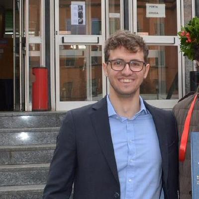

::: {.home-intro}
{.home-photo fig-alt="Matteo Foglieni" width=104 height=104}

::: {.home-text}
# Matteo Foglieni {.unnumbered .unlisted}

I'm Matteo, a physicist turned computational scientist. By day I work at the
Leibniz Supercomputing Centre in Munich, getting scientific codes to run on
Kubernetes and OpenStack cloud; the rest of the time I like taking things apart
until I understand them properly, and writing down what I find.

This is where that writing lives: careful notes on numerical methods, a bit of
physics, and the corners of computer science I find worth the detour — usually
with Julia somewhere in the mix. They begin as notes to myself, but I try to
make them clear enough to be worth your time too.

::: {.home-meta}
[Garching bei München, DE]{.home-location}
[GitHub](https://github.com/foglienimatteo)
[LinkedIn](https://linkedin.com/in/foglienimatteo)
[Mail](mailto:matteo.foglieni@lrz.de)
:::
:::
:::

## Recent posts {.home-section-title .unlisted}

::: {#recent-posts}
:::

[All posts →](blog/index.qmd){.post-list-more}
