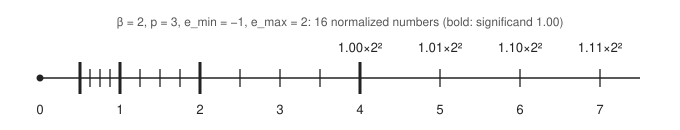

This page is a reference for writing posts. It is rendered but listed nowhere (`draft: true`): not in the blog index, the feed, the sitemap or the search.

## A new post

Create a folder under `blog/` with an `index.qmd` in it. The folder name is the address: `blog/my-new-post/index.qmd` becomes `/blog/my-new-post/`. Images go in the same folder.

```yaml
---
title: "Title of the post"
date: 2026-11-13
date-modified: 2026-11-20      # optional
categories: [math, physics]
---
```

The title comes from the front matter, so start the text with a `##` heading, not `#`.

## Text

Plain Markdown: *italic*, **bold**, `inline code`, [a link](https://quarto.org), and a footnote[^1].

[^1]: Footnotes are written `[^1]` in the text and `[^1]: ...` anywhere below.

> A block quote, for a statement taken from somewhere else.

A list needs an empty line before it:

- first item
- second item
  - nested item

## Math

Inline math is `$...$`: $e^{i\pi} + 1 = 0$. Display math is `$$...$$` with no empty line inside:

```markdown
$$
\int_{-\infty}^{+\infty} e^{-x^2} \, \dd x = \sqrt{\pi}
$$
```

$$
\int_{-\infty}^{+\infty} e^{-x^2} \, \dd x = \sqrt{\pi}
$$

A bare `$$...$$` has no number. `\tag{...}` sets one by hand:

```markdown
$$
\boxed{ \frac{\dd^2 y}{\dd x^2} = U(x) + V(x)\,y } \tag{1.1}
$$
```

$$
\boxed{ \frac{\dd^2 y}{\dd x^2} = U(x) + V(x)\,y } \tag{1.1}
$$

The `equation` and `align` environments are numbered automatically, and `\label` with `\eqref` gives a clickable reference. Write `\eqref` inside `$...$`:

```markdown
$$
\begin{align}
f'(x) &= \frac{f(x+h) - f(x-h)}{2h} + O(h^2) \label{eq:central} \\
f''(x) &= \frac{f(x+h) - 2f(x) + f(x-h)}{h^2} + O(h^2)
\end{align}
$$

The central difference $\eqref{eq:central}$ is second order.
```

$$
\begin{align}
f'(x) &= \frac{f(x+h) - f(x-h)}{2h} + O(h^2) \label{eq:central} \\
f''(x) &= \frac{f(x+h) - 2f(x) + f(x-h)}{h^2} + O(h^2)
\end{align}
$$

The central difference $\eqref{eq:central}$ is second order.

Site-wide macros are defined in `assets/head.html`: `\RR` $\RR$, `\dd` $\dd$, `\curl` $\curl$, `\abs{x}` $\abs{x}$, `\norm{v}` $\norm{v}$.

## Code

A fenced block with the language name is highlighted but not run.

```python
import numpy as np

def numerov_step(y0, y1, h, V):
    """One step of Numerov's method for y'' = V(x) y."""
    return (2 * y1 * (1 + 5 * h**2 * V[1] / 12) - y0 * (1 - h**2 * V[0] / 12)) / (1 - h**2 * V[2] / 12)
```

```cpp
#include <cmath>
#include <vector>

template <typename T>
T kahan_sum(const std::vector<T>& xs) {
    T sum = 0, c = 0;
    for (const T& x : xs) {
        T y = x - c;
        T t = sum + y;
        c = (t - sum) - y;   // the low-order bits lost in sum + y
        sum = t;
    }
    return sum;
}
```

```julia
using KernelAbstractions

@kernel function axpy!(y, a, @Const(x))
    i = @index(Global, Linear)
    y[i] = a * x[i] + y[i]      # works on CPU and GPU backends: α ⋅ x + y
end
```

A file name can be attached with ```` ```{.julia filename="spline.jl"} ````:

```{.julia filename="spline.jl"}
struct MySpline{T}
    x::Vector{T}
    y::Vector{T}
end
```

## Code that runs

A block written ```` ```{python} ```` (or ```` ```{julia} ````) is executed when the post is rendered, and its output is placed below it.

```{python}
from decimal import Decimal as D, Context, ROUND_HALF_EVEN

c3 = Context(prec=3, rounding=ROUND_HALF_EVEN)   # beta = 10, p = 3
b, a, c = D("3.34"), D("1.22"), D("2.28")
print("computed:", c3.subtract(c3.multiply(b, b), c3.multiply(D(4), c3.multiply(a, c))))
print("exact:   ", b * b - 4 * a * c)
```

A figure made by the code becomes a figure of the post. `#| echo: false` hides the source and shows only the result.

```{python}
#| label: fig-relative-spacing
#| fig-cap: "Spacing between neighbouring double precision numbers."
#| fig-alt: "Log-log plot of the spacing of double precision numbers against their magnitude: a staircase rising with slope one."
import numpy as np
import matplotlib.pyplot as plt

x = np.logspace(-3, 3, 400)
fig, ax = plt.subplots(figsize=(6.4, 3.2))
ax.loglog(x, np.spacing(x), color="#1c5cab", linewidth=2)
ax.set_xlabel("x")
ax.set_ylabel("distance to the next double")
ax.grid(True, which="major", color="#e4e2dc", linewidth=0.8)
ax.spines[["top", "right"]].set_visible(False)
plt.show()
```

The output is stored in `_freeze/` and reused until the source of the post changes, so the code runs once, on your machine, and never on the server. Running it needs Python with `jupyter` (plus whatever the code imports), or Julia.

## Interactive figures

A ```` ```{ojs} ```` block is JavaScript that runs in the reader's browser. `Inputs` gives sliders and number boxes, `Plot` draws, and every block that uses a value is recomputed when the value changes. The post [Bank interest functions: plots](../blog/bank-loan-interest-plots/index.qmd) is a full example.

::: {.controls}
```{ojs}
//| echo: fenced
viewof k = Inputs.range([1, 12], {value: 3, step: 1, label: "Harmonics k"})
```
:::

::: {.chart}
```{ojs}
//| echo: fenced
Plot.plot({
  width,
  height: 260,
  marginLeft: 44,
  x: {label: "x →"},
  y: {label: "↑ partial sum of the square wave", domain: [-1.3, 1.3], grid: true},
  marks: [
    Plot.ruleY([0]),
    Plot.lineY(d3.range(0, 2 * Math.PI, 0.01), {
      x: x => x,
      y: x => d3.sum(d3.range(k), n => Math.sin((2 * n + 1) * x) / (2 * n + 1)) * 4 / Math.PI,
      stroke: "var(--chart-3)",
      strokeWidth: 2,
      tip: {fill: "var(--site-bg)", stroke: "var(--site-muted)"}
    })
  ]
})
```
:::

Wrapping the inputs in `::: {.controls}` and the plot in `::: {.chart}` gives them the frame and fonts used above. The colours `var(--chart-1)` to `var(--chart-6)` and `var(--chart-highlight)` follow the light and dark mode, and so does the hover box when it is given the page colours as above.

## Images

An image with a description becomes a figure with a caption. The file sits next to the post.

```markdown
{width=80%}
```

{width=80%}

## Tables

| Format    | $p$ | $e_{\min}$ | $e_{\max}$ |
|:----------|----:|-----------:|-----------:|
| single    |  24 |     $-126$ |      $127$ |
| double    |  53 |    $-1022$ |     $1023$ |

: Parameters of the IEEE 754 binary formats.

## Callouts

::: {.callout-note}
A note. Also available: `callout-tip`, `callout-warning`, `callout-important`.
:::

::: {.callout-warning title="Careful"}
A warning with its own title.
:::

::: {.callout-tip collapse="true" title="Folded by default"}
Add `collapse="true"` for content the reader can open.
:::

## PDF preview card

Used on the CV and Publications pages: a picture of the first page that opens the PDF.

```markdown
{}
```

Make the picture with `bin/pdf-preview <file.pdf>`.
